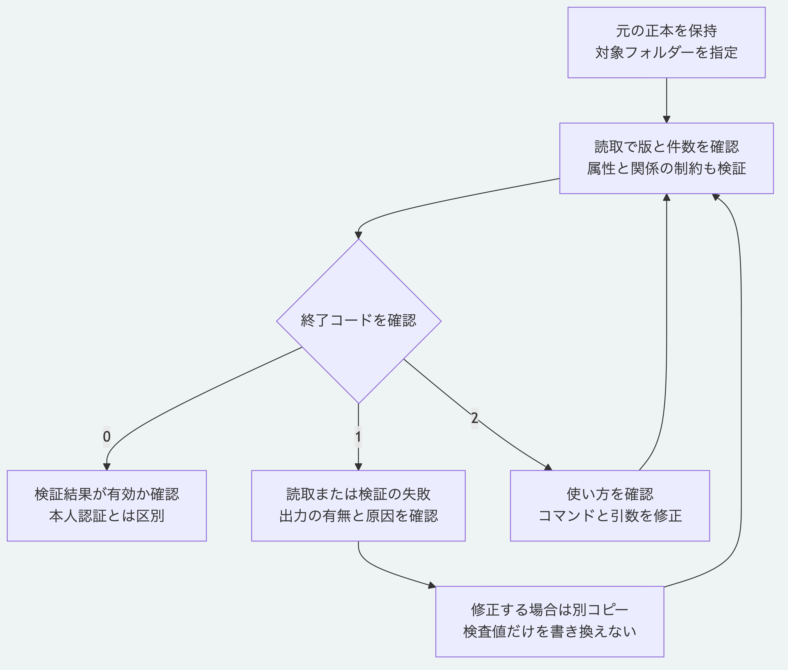

# 正本を検査して失敗の原因を切り分ける

自分の正本を使う前に、読取と検証を行います。
これらのコマンドは入力を書き換えません。
対象は公開リポジトリの現在の`main`で、Node.js 26.13.0以上、導入済みの依存と、Pythonの節では3.14または3.15を使います。
準備は[最初のチュートリアル](getting-started.md)の手順1を参照してください。
以下はリポジトリ直下のPOSIX互換のシェルで実行します。

## 1. 入力と確認範囲を選ぶ

Node.jsには`.morivyx`を含むフォルダーを渡します。
空白を含むパスも引用符で囲みます。

```sh
node packages/kernel/src/cli.js inspect "/path/to/project"
node packages/kernel/src/cli.js validate "/path/to/project"
```

`/path/to/project`を実際の保存先へ置き換えます。
`inspect`は読取、保存済みの検査値との照合、版と件数の確認に使います。
`valid: true`は、その読取が成功したことを示します。
Schema本文による属性とGraphの制約は、`validate`で検証します。
例えばSchema本文が欠けている場合、Nodeの`inspect`が成功しても`validate`は失敗します。
このため、利用前の確認では両方を実行します。
検証の成功は、本人認証、承認権限や署名の検証を意味しません。

## 2. 終了コードと出力を確認する

直前のコマンドの終了コードは、すぐ次の行で確認します。

```sh
node packages/kernel/src/cli.js validate "/path/to/project"
echo $?
```

| 結果 | 終了コード | 出力と確認点 |
|---|---|---|
| 検証成功 | `0` | 標準出力のJSONが`valid: true`、`issues: []` |
| 検証または読取の失敗 | `1` | 標準出力のJSONが`valid: false`。`issues`の`code`と`path`を確認 |
| コマンドや引数の不正 | `2` | 使い方を標準エラーへ出力。JSONとして読まない |

この表は必要な実行環境を準備したNode CLIの`validate`についてのものです。
Nodeや依存自体を起動できない場合は、実行環境のエラーを先に解決します。
すべての失敗に説明文が付くとは限らないため、`message`の有無だけでは判定しません。
必要なら`> result.json 2> error.txt`で出力先を分けられますが、同名の既存ファイルを上書きする点に注意してください。
自動処理では、終了コードを確認してからJSONの有無と内容を確認します。

## 3. 失敗した箇所を確認する

| `code` | この手順で再現する原因 | 次の確認 |
|---|---|---|
| `PACKAGE_FILE_MISSING` | 指定先に必須ファイルがない | フォルダーの指定と`path`のファイルの有無 |
| `PACKAGE_YAML_INVALID` | YAMLの構文が壊れている | 指摘されたファイルの引用符、字下げと括弧 |
| `REVISION_ID_MISMATCH` | 内容だけを手で変更し、保存した検査値と一致しない | 元の保存版と変更内容を比較 |
| `SCHEMA_LOCK_MISSING` | 一覧に記録したSchemaの本文がない | 対応する版のSchema本文と一覧を確認 |

この表は再現例であり、すべてのエラーの一覧ではありません。
作成規則に違反するYAMLには別のエラーが出ることもあります。
元を保存し、修正が必要なら別コピーで確認します。
不一致を消すために、保存済みの検査値だけを書き換えたり、`reindex`を修復の代わりに実行したりしません。
判断を変更したい場合は、[判断の改訂](revise-decision.md)のように変更理由と履歴を保存する操作を使います。

## 4. Pythonで検証する

Pythonのファイル読取には、`.morivyx`そのものを明示します。
Nodeのコマンドへ渡した一つ上のフォルダーとは異なります。
シンボリックリンクを経由しない実体のフォルダーを指定します。

```sh
python3 -B packages/portable-core/package_records.py "/path/to/project/.morivyx"
python3 -B packages/portable-core/package_validation.py "/path/to/project/.morivyx"
echo $?
```

読取結果の件数だけで検証完了とはせず、2つ目の検証結果と`validation`に示す確認範囲を読みます。
成功は終了コード`0`で、検証結果は`valid: true`です。
失敗は終了コード`1`です。
意味の検証結果が得られた場合はJSONを返しますが、読取不能の場合は標準出力が空で、標準エラーへ`package validation failed; no result produced`と出ます。
Nodeの`issues`と同じ診断形式を想定しません。
不正な引数は終了コード`2`で、使い方を標準エラーへ返します。
PythonでもSchema本文が欠けた正本の読取は成功する場合がありますが、読取結果の`schemaValidated`は`false`で、意味の検証は失敗します。
入力を準備した後、これらのPythonコマンドはNode.js、Gitと通信を使いません。

## 5. 手順の成功と失敗を再現する

次は自分の正本のパスを受け取らず、専用の一時フォルダーへサンプルと失敗例のコピーを作ります。

```sh
node tools/check-validation-tutorial.mjs python3
```

両実装で正常な読取と検証、必須ファイルの欠落、不正なYAML、内容と検査値の不一致、Schema本文の欠落及び引数不正を確認します。
Nodeの読取だけが成功するSchema本文欠落の例と、Pythonへ誤った階層を渡した場合も含めます。
元のサンプルと失敗例の全ファイルを実行前後で比較し、コマンドが入力を作成したり変更したりしないことを確認します。
`valid: true`を表示した後、専用の一時フォルダーを除去します。
一般の正本を自動修復する道具ではありません。



[図の生成元](../diagrams/validate-package.mmd)

[利用手順の入口](README.md)と[仕様の入口](../README.md)へ戻れます。
