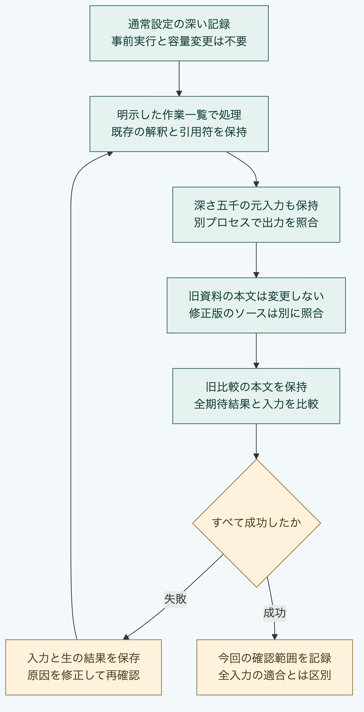

# 通常設定で深いYAMLを読み書きする

深い拡張値の読取と書出しを、Node.jsの既定スタックと実行条件のまま行えます。
Node.jsは`26.13.0`以上を使い、[導入手順](../../README.md#導入と検査)で依存物を準備します。
次の例はリポジトリ直下から実行し、既存の正本を変更しません。

## 深さ1024の対応表を保存して読む

```sh
node --input-type=module <<'JS'
import assert from "node:assert/strict";
import { mkdtemp, writeFile, rm } from "node:fs/promises";
import { tmpdir } from "node:os";
import { join } from "node:path";
import { serializeYamlRecord } from "./packages/kernel/src/yaml-writer.js";
import { readYamlRecord } from "./packages/kernel/src/yaml-reader.js";

let value = "leaf";
for (let i = 0; i < 1024; i++) value = { probe: value };
const source = serializeYamlRecord({
  format: "morivyx.git-graph/0.1",
  extensions: { "example.test/deep": value },
});
const directory = await mkdtemp(join(tmpdir(), "morivyx-deep-example-"));
try {
  const path = join(directory, "record.yaml");
  await writeFile(path, source);
  let result = (await readYamlRecord(path)).extensions["example.test/deep"];
  for (let i = 0; i < 1024; i++) result = result.probe;
  assert.equal(result, "leaf");
  console.log("深さ1024の保存と読取を確認しました。");
} finally {
  await rm(directory, { recursive: true, force: true });
}
JS
```

最後に確認の文が表示され、作成した一時ファイルは削除されます。
ソース直下の読取関数を使う例です。
別アプリからの導入は[公開APIの利用手順](installed-node.md)を参照してください。
文字列変換と低水準の読取は、Graphの意味、識別子又は採用権限を検証する入口ではありません。

## 変更した処理と保持する規則

構造の確認、文字の正規化、空値と項目順、文書の組立て、深い構文の解釈と出力を、明示した作業一覧で進めます。
浅い読取に使う再帰処理は深さ64までに限り、それを超える入力も別の処理で扱います。
64を入力の受理上限にはしません。
引用符と字下げ及び値の解釈には固定した`yaml 2.9.1`の処理を使い、依存物の共有状態を変更しません。
論理値からの書出しにはタグと指示行がないため、それを探す不要な再帰も省きます。
コメント、別名、タグ、重複と不正な項目順を許す変更ではありません。
直接呼び出す正規化関数も循環参照を拒否し、循環しない共有値は従来どおり正規化します。
入れ子の重複を先に報告し、前の要素で失敗した場合に後の配列要素を先読みしない従来の処理順も保持します。
実行資源は有限であり、任意の大きさの入力への成功を保証しません。

Pythonの製品は47本のままで、既存の関数の容量と深さの制限も保持します。
[Pythonの文字列変換](python-yaml-serialization.md)、[報告の入出力](python-report-file-api.md)、[一つの記録の読取](python-yaml-file-api.md)と[パッケージの三入口](python-package-file-api.md)は従来のAPIを使えます。

## 元の期待結果との比較を実行する

旧資料の695件、1041件、5045件、1063件、台帳156件と移行保存194件は、本文と期待結果を変更しません。
修正版の十八ファイルの検査値は、`packages/portable-core/fixtures/yaml-runtime-source-integrity.json`へ別に記録します。
元のソースと同じ版であるとは説明しません。
比較用の処理では、取り込み、試験の説明と起動時のソース照合だけを変更し、それらを戻した全本文が旧版と一致することも検査します。
入力構成、正規化、呼出し観測、再実行と等値判定の変更は拒否します。

```sh
node --test packages/kernel/test/yaml-depth-runtime.test.js
node --test tools/reference-source-integrity.test.mjs
MORIVYX_REFERENCE_PYTHON=python3.14 node tools/python-yaml-serialization-conformance.test.mjs
MORIVYX_REFERENCE_PYTHON=python3.15 node tools/python-yaml-file-api-conformance.test.mjs
MORIVYX_REFERENCE_PYTHON=python3.15 node tools/python-package-file-api-conformance.test.mjs
MORIVYX_REFERENCE_PYTHON=python3.15 node tools/python-ledger-store-conformance.test.mjs
MORIVYX_REFERENCE_PYTHON=python3.15 node tools/python-package-migration-writer-conformance.test.mjs
```

各比較は、旧全期待値の再現と、公開47本だけを複写してNodeとGitを利用不能にしたPythonの実行も含みます。
深さ5000の配列という既存入力も削除せず、二回の新しいプロセスで正確な出力を確認します。
全機能の独立適合、長期互換、別のOS、任意の競合、実際の本人性と実外部環境の検証は未完了です。



[図の生成元](../diagrams/yaml-runtime-repair.mmd)
