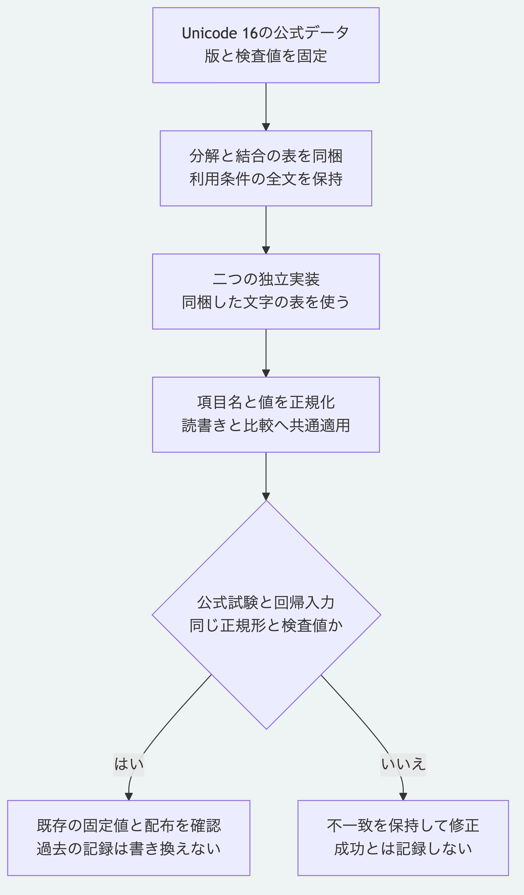

# 文字の正規化とUnicodeの版

現在の中核は、Unicode 16.0.0のNFCで文字列を正規化します。
Node.jsとPythonの実行環境が持つUnicodeの版に任せず、同梱した表で処理します。
Pythonは標準機能だけで使え、実行時に追加ライブラリの導入や通信を必要としません。

## 版を固定する理由

実行環境の更新で、以前は未割当だった文字が結合文字として扱われるようになると、同じ入力から異なる正規形と検査値を生成する場合があります。
例えば`U+0061 U+0315 U+05C8 U+0300`は、Unicode 16と18で正規化の結果が異なります。
[Unicodeの正規化仕様](https://www.unicode.org/reports/tr15/tr15-56.html)の版間の安定性は、両方の版で割当済みの文字を対象とします。

初期公開環境のNode.js 22.13.0が[同梱したUnicodeの版](https://github.com/nodejs/node/blob/v22.13.0/deps/icu-small/source/common/unicode/uchar.h)は16です。
現在の実装をこの挙動へ揃え、実行環境の更新だけで検査値が変わることを防ぎます。
旧版のNode.jsを実行する必要はありません。
通常のNode.js最低要件は26.13.0のままです。

## 適用範囲

項目名、文字列値、並び順、比較、YAMLの読書きと判断の表示へ同じ処理を使います。
この版で未割当の文字も拒否せず、Unicode 16の処理に従って保持します。
単独サロゲートの拒否、公開APIと検査値の接頭辞は維持します。

Pythonの`canonical.py`は、同じフォルダーの`unicode_nfc.py`を読み込みます。
持ち運ぶ場合は必要な共通モジュールも含め、`packages/portable-core`をフォルダーごとコピーします。
正規化の内部モジュールは、Node.jsの公開APIには追加していません。

既存の正本、固定した試験入力、初期公開タグ`v0.1.0`と由来の一覧は書き換えません。
後のUnicodeの処理で既に保存した検査値は自動変換しません。
読取で不一致が出た場合は、元の入力と生成環境を保持して確認します。
将来Unicodeの版を変更する場合も、既存の検査値と読取への影響を調べる必要があります。

## 公式データと再照合

元データは`https://www.unicode.org/Public/16.0.0/ucd/`から取得しています。
利用条件は[外部依存の表示](../THIRD_PARTY_NOTICES.md)と各実装内の全文へ記載しています。

| 元ファイル | SHA-256 |
|---|---|
| `UnicodeData.txt` | `ff58e5823bd095166564a006e47d111130813dcf8bf234ef79fa51a870edb48f` |
| `DerivedNormalizationProps.txt` | `4d4c03892dea9146d674b686e495df2d55a28d071ac474041d73518f887abddc` |
| `NormalizationTest.txt` | `d811971453e7075e1ad56fb1b301eece5aa80757b81f6156e74a1bfb3ae5ceb1` |

実行時の表は最初の二つから必要な項目を抽出した派生物です。
試験用の派生物は区分と五つの列を保持し、説明のコメントを省いています。
試験用の派生物の検査値は`c31999696cce2be0611ab5ac4335f451612740b921b2a59a9f139071d8cb654d`です。

次の再照合だけはネットワークを使い、公式ファイルの検査値と同梱内容の一致を確認します。
リポジトリのファイルは書き換えません。

```sh
python3 tools/generate-unicode-data.py js --check
python3 tools/generate-unicode-data.py py --check
python3 tools/generate-unicode-data.py tests --check
```

## 適合検査

Node.jsの通常の適合検査に、公式19,965例の各五条件と、公式Part1にない全単独文字の確認を含めています。
Pythonの同じ検査は通常の単体検査へ含めています。
長い結合文字列、項目名と値、重複の拒否とYAMLの往復も確認します。

```sh
npm run conformance --prefix packages/kernel
python3 -B -m unittest discover -s packages/portable-core -p 'test_*.py'
```

再現入力を項目名と値へ一度ずつ使った対応表の正規JSONは21バイトで、`morivyx:schema:v1`の検査値は次です。

```text
sha256:e67d7eb81d14544f62a52312c13f78a02c4e883e8638e321b656dc34d592505d
```



[図の生成元](diagrams/unicode-normalization.mmd)
