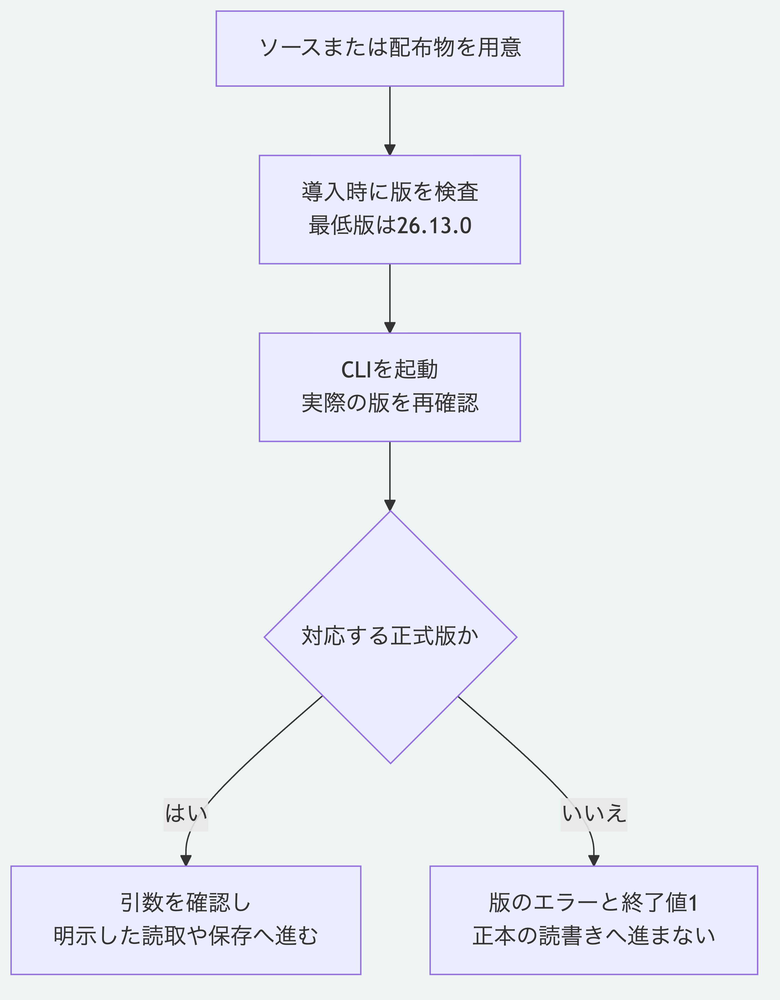

# CLIを直接実行するときのNode.js最低版の確認

2026-11-02に、公開側の`609d3eef7fbf8e20721f079ef92f0fe9e4cc1de3`を基に、CLIの実行時検査を追加した。
最低版26.13.0の宣言は維持し、導入後に実行環境を切り替えた場合も入口で検査する。
公開APIと正本の形式、初版タグ及び由来の一覧は変更していない。

## 確認した結果

| 対象 | 結果 |
|---|---|
| 最低版と後続の正式版 | 26.13.0、26.13.1、26.14.0、27.0.0などを受理 |
| 下限未満と不正な版 | 26.12.99以下、先行版、桁の欠落、不要な接頭辞と安全な整数の範囲外を拒否 |
| 導入要件との整合 | 検査の下限が`engines.node`と一致し、導入時の厳格な版検査も有効 |
| 処理前の停止 | 版を模擬した子プロセスで6種類の引数を確認。ファイル操作を検出する検査を有効にしても、版のエラーだけで終了 |
| 実際の旧版 | Node.js 26.0.0と22.13.0で各4種類の起動を拒否。終了値1、`NODE_VERSION_UNSUPPORTED`、標準エラーは空。入力と出力のファイルは作られない |
| 現行版の適合検査 | Node.js 26.13.0で653件成功、失敗と省略は0件。後続の契約、局所通信、配布と実例の監査も成功 |
| 配布物 | 検査コードを含む70ファイル。公開対象52件と導入した公開API51件を維持 |
| 利用手順 | 作成、改訂と履歴、Pythonでの読取及び関係の追跡が成功 |

最低版未満の実行物は、拒否の確認だけに使った。
旧版の検査では、開発側の事前読込による拒否と混同しないよう、子プロセスの`NODE_OPTIONS`だけを外して公開CLI自身の応答を確認した。
既存の正本を改変する操作や旧版での通常開発は行っていない。
この変更はCLIの入口の検査であり、ライブラリの全公開関数へ実行時検査を追加するものではない。

実行したコマンドは`node --test packages/kernel/test/node-runtime.test.js`と`npm run conformance --prefix packages/kernel`である。
利用手順は`tools/check-getting-started.mjs`と`tools/check-trace-tutorial.mjs`で確認した。
適合検査に4件を加え、既存の649件を維持した。

[図の生成元](../diagrams/cli-runtime-minimum.mmd)
