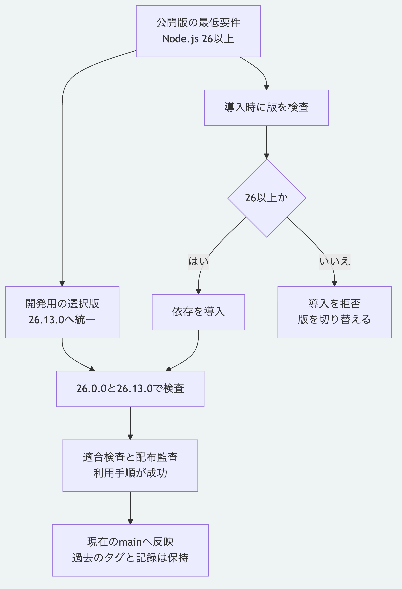

# Node.js 26以上への最低要件の変更

2026-11-02の利用者の指示に従い、現在の`main`のNode.js要件を`>=26.0.0`へ変更した。
開発用の選択版は`.nvmrc`と`.node-version`で`26.13.0`へ揃えた。
26.0.0以上の安定版を要件とし、26.13.0だけに動作範囲を制限する設定ではない。
過去のタグ`v0.1.0`、初版の由来の一覧と過去の検証結果は保持する。

## 設定と導入

`packages/kernel/package.json`の`engines.node`と、対応するlockの宣言を`>=26.0.0`にした。
リポジトリ直下とKernelの`.npmrc`に`engine-strict=true`を置き、Kernelの既存の`ignore-scripts=true`は維持した。
導入先のアプリには配布元の`.npmrc`が引き継がれないため、チュートリアルでは`--engine-strict`を明示する。

`engines`の宣言だけでは依存として導入するときに警告へ留まるため、[npmの厳格な版検査](https://docs.npmjs.com/cli/v11/using-npm/config/#engine-strict)を使う。
版の選択ファイルは、対応する管理用の道具が利用する設定であり、OS全体のNode.jsを変更するものではない。
既存のCLIを直接起動する際の強制停止機能は追加していない。
Node.js 26は確認日時点で[公式のLTS版](https://nodejs.org/en/about/previous-releases)である。

## 確認結果

環境はmacOSのarm64である。
最低版の26.0.0は公式配布物を取得し、公式の`SHASUMS256.txt`と照合した。
配布物の`SHA-256`は`dcee8564c1a9342f9594dd5e52d533894dfef6b85aa771bbbb870baa3c403235`である。

| 確認対象 | 結果 |
|---|---|
| Node.js 26.0.0での`npm ci` | 成功 |
| Node.js 26.0.0での`npm run conformance` | 全件成功。行96.90%、分岐94.18%、関数99.48%で閾値を達成 |
| Node.js 26.13.0での`npm run conformance` | 649件成功、失敗と省略0件。行96.90%、分岐94.19%、関数99.48% |
| 両版の契約、固定通信、配布と実例の監査 | すべて成功。配布69ファイル、公開対象52件、導入済みの公開exportは51件 |
| 26.0.0とPython 3.15.2でのチュートリアル | 判断の追加、差分、元の内容維持と検査値一致に成功 |
| 26.13.0とPython 3.14.10でのチュートリアル | 同じ一連の操作に成功 |
| Node.js 22.13.0での`npm ci` | 終了値1、`EBADENGINE`で拒否。要求は`>=26.0.0`と表示 |
| Kernel側の実効設定 | `npm config get engine-strict --prefix packages/kernel`が`true` |

SDK本体の処理、依存ライブラリの版とPythonの要件は変更していない。
将来のNode.jsの全版で検査を実施したという記録ではない。
GitHub Actions、外部の実サービスと実機は使用していない。

[図の生成元](../diagrams/node-26-minimum.mmd)と[利用手順](../tutorials/getting-started.md)を参照できる。
