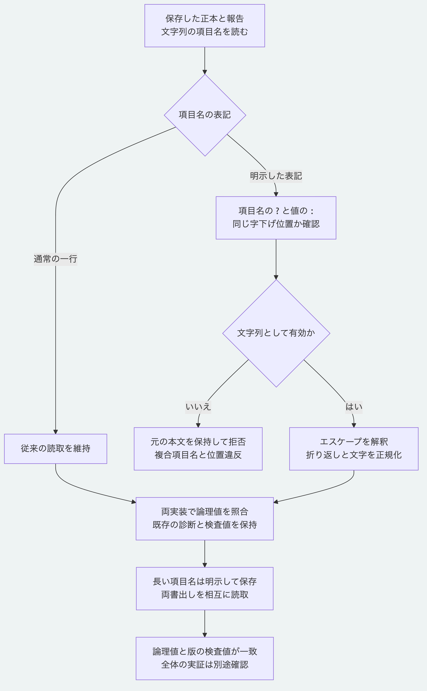

# 明示した文字列項目名と長い項目名を相互に読み書きする

Node.jsとPythonは、`?`で文字列の項目名を明示し、次の行の`:`で値を分ける表記を読み取ります。
長い項目名は両方の書出しで必要に応じてこの表記を使い、論理値と版の検査値を保持します。
現在の`main`の対応であり、初版のタグ`v0.1.0`にはこの改修を含めません。

## 使える表記

次の構文の例は、`first second`という項目名に`value`を対応させます。
正本の記録には、この表記に加えて形式ごとの必須項目と検証が必要です。

```yaml
? "first
  second"
: "value"
```

項目名の`?`と値の`:`の字下げ位置はそろえます。
引用符なし、一重引用符と二重引用符、複数行の折り返し、項目名を`?`の次の行へ分ける表記を扱います。
入れ子と一覧内の対応表、値の側の簡潔な対応表と一覧にも対応します。
折り返し、空行とエスケープを解釈してNFCへ正規化し、重複する項目名を拒否します。
一覧と対応表の項目名、省略した項目名、タグ、参照とコメントは拒否します。
Pythonの8 MiBと128段の上限は維持します。

## 長い項目名を持ち運ぶ

通常の一行の項目名には長さの制約があるため、長い項目名は明示して書き出します。
従来は、Nodeが1025文字の項目名を書き出すとPythonが読めず、Pythonの出力もNodeが拒否していました。
Pythonの書出しも、引用符とエスケープを含む表記が1024の長さを超える場合に明示表記へ切り替えます。
UTF-16の単位で数える読取との互換性も保つため、補助面の文字を含む項目名は早めに明示表記になる場合があります。
項目名自体を短くしたり、別の名前へ置き換えたりはしません。
従来の有効な出力、固定資料と過去の期待値は保持します。

## 字下げ違反の扱い

Nodeの解析器が従来受け入れていた、`?`と`:`の位置が異なる表記も拒否します。
YAML 1.2.2の[ブロック対応表の規則191](https://yaml.org/spec/1.2.2/#822-block-mappings)に従い、元の位置を確認して`PACKAGE_AUTHORING_PROFILE_INVALID`を返します。
既存のファイルは自動で書き換えません。
不正とされた入力は元を保持し、位置をそろえた別のコピーで読取と検証を確認します。

## 対応を確認する

Node.js 26.13.0以上と、導入済みの依存を使い、リポジトリ直下で実行します。

```sh
python3 -B -m unittest discover -s packages/portable-core -p test_yaml_explicit_keys.py
node --test packages/kernel/test/yaml-explicit-keys.test.js tools/python-yaml-explicit-keys-conformance.test.mjs
```

相互照合は`MORIVYX_REFERENCE_PYTHON`に使うPythonの実行パスを指定できます。
1090入力の受理と論理値、既存の表記違反716件の診断、正本12例と報告28例を両PythonとNodeで照合します。
長さの境界、引用符、エスケープ、補助面の文字と値の入れ物を組み合わせた76記録では、両書出しの相互読取と版の検査値を確認します。
NodeとGitを探索できない専用の空の探索先でも、本番用Pythonモジュールだけで選択した四例を再現します。
完全なYAML処理系への適合、署名、本人性と正本全体の真正性の検証とは区別します。



[図の生成元](diagrams/yaml-explicit-keys.mmd)

[仕様の入口](README.md)と[Pythonの範囲](../packages/portable-core/README.md)へ戻れます。
