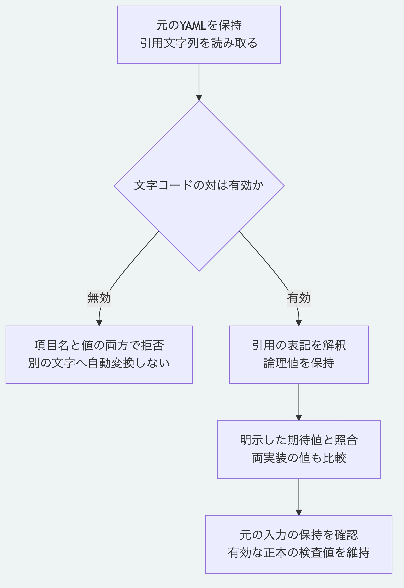

# YAML引用文字列の折り返しと正しい文字コード

現在の`main`は、項目名と値の両方で、対にならないUTF-16のエスケープを読取時に拒否します。
ファイル自体がUTF-8でも、エスケープを解釈した文字列が不正な対になる場合があります。
Pythonの読取とNodeのcanonical formは既に拒否していましたが、以前のNodeのYAML読取だけはその値を返していました。
今回、Nodeの読取入口でも同じ制約を適用します。
初版のタグ`v0.1.0`は変更していません。

## 有効な対と不正な表記

| 引用文字列の表記 | 現在の読取結果 |
|---|---|
| `"\uD83D\uDE00"` | 有効な対として`😀`を保持 |
| `"\U0001F600"` | 同じ補助面の文字`😀`を保持 |
| `"😀"` | 同じ文字を保持 |
| `"\uD800"` | 単独の上位の文字コードを拒否 |
| `"\uDC00"` | 単独の下位の文字コードを拒否 |
| `"\uDE00\uD83D"` | 逆順の対を拒否 |
| `"\uD83Dx\uDE00"` | 途中で分断された対を拒否 |

不正な入力を別の文字へ自動で置き換えません。
以前のNodeの読取だけが返した入力は、元を保存し、意図した文字を確認して別コピーで見直します。
保存済みの検査値だけを書き換えて不一致を消しません。
有効な正本の出力、文字の正規化と検査値の計算規則は変更していません。

## 折り返しとエスケープを確認する

[YAML 1.2.2の引用文字列](https://yaml.org/spec/1.2.2/#73-flow-scalar-styles)を参照し、Morivyxの作成規則の範囲で次の表記を扱います。
例えば、次の値は`a b`になります。

```yaml
value: "a
  b"
```

次の値は行末の改行をエスケープするため、`ab`になります。

```yaml
value: "a\
  b"
```

空行、行末の空白とエスケープの位置によって論理値が変わるため、単純に改行や空白を取り除く処理をしません。
値の一重引用符、暗黙の項目名の複数行表記、不正な字下げとエスケープは引き続き拒否します。
明示した文字列項目名の引用と折り返しについては、[明示した項目名の案内](yaml-explicit-keys.md)も参照してください。

## 継続検査を実行する

Node.js 26.13.0以上と導入済みの依存を使い、リポジトリ直下で実行します。

```sh
node --test packages/kernel/test/yaml-folding.test.js tools/python-yaml-folding-conformance.test.mjs
```

`MORIVYX_REFERENCE_PYTHON`へ使うPythonの実行パスを指定できます。
Python 3.14と3.15で、888入力のうち465例の期待値を保持し、423例を拒否することを確認しています。
両実装同士の一致だけでなく、明示した期待値ともそれぞれ照合します。
根、入れ子、一覧、一覧内の対応表、明示した項目名と文書全体の字下げを含み、元の入力は変更しません。
単独の文字コードを拒否することと、有効な対及び補助面の文字を受け入れることを両方確認します。
完全なYAMLへの適合、本人性と署名の検証及び正本全体の真正性を認定する検査ではありません。



[図の生成元](diagrams/yaml-folding.mmd)

[仕様の入口](README.md)と[Pythonの範囲](../packages/portable-core/README.md)へ戻れます。
