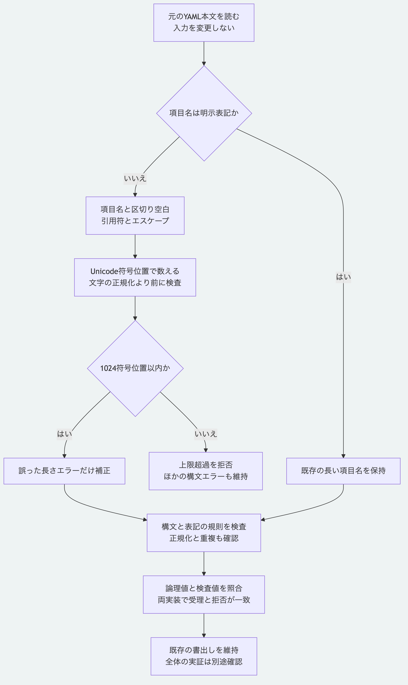

# 一行のYAML項目名の長さを正しく数える

Node.jsとPythonは、`?`を省略して項目名と`:`を同じ行へ書く場合、元の表記を1024 Unicode符号位置以内に制限します。
引用符、エスケープと`:`の前の区切り空白も数え、字下げと一覧の`- `は含めません。
現在の`main`の改修で、初版のタグ`v0.1.0`には含めません。

## 文字数を数える範囲

YAML 1.2.2の[一行の項目名の規則](https://yaml.org/spec/1.2.2/#822-block-mappings)に従い、元の表記全体を検査します。
Unicodeエスケープを解釈した後や、NFCへ正規化した後の項目名の長さでは判定しません。

| 表記 | 結果 |
|---|---|
| 引用符なしの`a`が1024個 | 受理 |
| 引用符なしの`😀`が1024個 | 1024符号位置として受理 |
| 二重引用符内の`😀`が1022個 | 引用符も含む1024符号位置として受理 |
| 引用符なしの`a`が1025個 | 上限超過として拒否 |
| 長いUnicodeエスケープの表記 | 元の表記が上限を超えれば、解釈後の項目名が短くても拒否 |
| `key`と区切り空白1022個 | 合計1025符号位置のため拒否 |
| NFCへ正規化すると短くなる表記 | 元の表記が上限を超えれば拒否 |

従来のPythonは上限超過も受け入れ、NodeはUTF-16の単位で数える解析器の結果により、有効な補助面の文字を拒否していました。
Pythonは元の表記を検査し、Nodeは報告された長さエラーの元の範囲を再確認します。
制約内であると確かめた長さの誤判定だけを補正し、ほかの構文エラーと表記違反は維持します。
明示した長い項目名の読取と、両方の既存の書出し形式も保持します。

## 上限超過として拒否された場合

以前のPythonだけが受け入れた上限超過の表記は、現在の読取では拒否されます。
元のファイルを保存した上で、[明示した項目名の表記](yaml-explicit-keys.md)を使う別のコピーへ移します。
既存の項目名と引用符、値の本文は保ち、同じ字下げ位置の`? 項目名`と`: 値`へ分けます。

次は構造の例です。
`name`を元の長い項目名へ読み替え、値の構造はそのまま保ちます。

```yaml
name: "value"
```

```yaml
? name
: "value"
```

一覧内では、`?`と`:`の位置をそろえます。

```yaml
items:
  - ? name
    : "value"
```

別のコピーを現在の読取と検証へ渡し、保存済みの検査値と一致することを確認します。
検査値を変更して不一致を消す処理は行いません。
この改修自体は、元のファイルを自動で書き換えません。

## 対応を確認する

Node.js 26.13.0以上と導入済みの依存を使い、リポジトリ直下で実行します。

```sh
python3 -B -m unittest discover -s packages/portable-core -p test_yaml_key_length.py
node --test packages/kernel/test/yaml-key-length.test.js tools/python-yaml-key-length-conformance.test.mjs tools/yaml-key-length-recovery.test.mjs
```

相互照合は`MORIVYX_REFERENCE_PYTHON`に使うPythonの実行パスを指定できます。
1062入力、正本5例と報告14例で、受理と拒否、論理値、検査値と元の入力の保持を確認します。
引用符、エスケープ、区切り空白、補助面の文字、NFC前の長さ、根と入れ子及び一覧内を含みます。
NodeとGitを探索できない専用の空の探索先でも、本番用Pythonモジュールだけで選択した四例を再現します。
重複、実際の上限超過、引用しない値、字下げ違反、複数行の通常項目名、括弧内の非空表記とタグを、長さの補正で成功へ変えないことも確認します。
案内の確認では、拒否された正本と報告の各一例から明示表記の別コピーを作り、両実装で保存済みの検査値との一致を確認します。
元のファイルと、記録済みの版とSchemaの検査値は変更しません。
完全なYAML処理系、本人性と署名や正本全体の真正性の検証とは区別します。



[図の生成元](diagrams/yaml-key-length.mmd)

[仕様の入口](README.md)と[Pythonの範囲](../packages/portable-core/README.md)へ戻れます。
