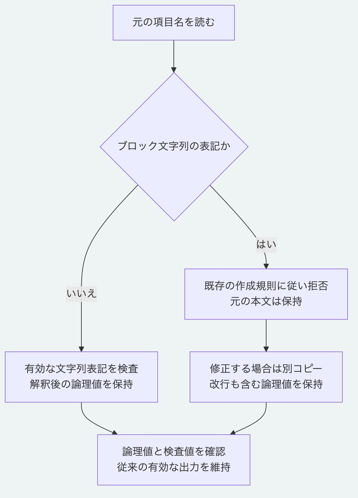

# YAML項目名の禁止表記と直し方

Morivyxの作成規則では、`|`と`>`で始まるブロック文字列を項目名にも使えません。
以前のNode.jsは項目名だけを受け入れていましたが、現在の`main`はPythonと同じく拒否します。
初版のタグ`v0.1.0`の内容は変更していません。

## 拒否する表記と有効な引用

次は一般のYAMLとして項目名が`format`になりますが、Morivyxの作成規則では拒否します。

```yaml
? |-
  format
: "value"
```

`>`による折り返し、末尾改行の指定と字下げの指定、空の内容、入れ子や一覧内の項目名も同じです。
通常の文字列項目名、一重引用符と二重引用符、明示した文字列項目名の折り返しとエスケープは有効です。
`"|": ">"`のように引用した記号も有効です。
すべての複数行の項目名を禁止する変更ではありません。

## 元を保存して別コピーを直す

この改修は元のファイルを書き換えません。
以前のNode.jsだけが受け入れた表記は、元を保存し、別のコピーで項目名を引用します。
上の例は末尾改行を取り除く`|-`のため、次の表記で同じ論理値になります。

```yaml
"format": "value"
```

`|`と`|+`では、末尾の改行が項目名の一部になる場合があります。
例えば次の二つは、項目名に一つの改行を含む同じ論理値です。

```yaml
? |
  name
: "value"
```

```yaml
"name\n": "value"
```

元の折り返し、空行、末尾改行と字下げの指定に応じた論理値を保持してください。
`>`を`|`と同じ置換で処理したり、末尾改行を無条件に削除したりしません。
項目名以外の値と構造も保持し、別コピーを現在の読取と検証へ渡して保存済みの検査値と一致することを確認します。
一致しない場合は置換を見直し、検査値を変更して不一致を消しません。

## 対応を確認する

Node.js 26.13.0以上と導入済みの依存を使い、リポジトリ直下で実行します。

```sh
node --test packages/kernel/test/yaml-key-style.test.js tools/python-yaml-key-style-conformance.test.mjs
```

相互照合は`MORIVYX_REFERENCE_PYTHON`へ使うPythonの実行パスを指定できます。
Python 3.14と3.15で、224入力のうち禁止216例を拒否し、有効な引用8例の論理値を保持することを確認しています。
正本2例と報告14例でも、一般のYAMLとして同じ論理値になる禁止表記を拒否し、元の入力を保持します。
有効な既存の出力、文字の正規化、容量と入れ子の上限、[明示した長い項目名](yaml-explicit-keys.md)及び[一行の項目名の長さ制約](yaml-key-length.md)は維持します。
完全なYAML処理系、本人性や署名及び正本全体の真正性の検証とは区別します。



[図の生成元](diagrams/yaml-key-style.mmd)

[仕様の入口](README.md)と[Pythonの範囲](../packages/portable-core/README.md)へ戻れます。
