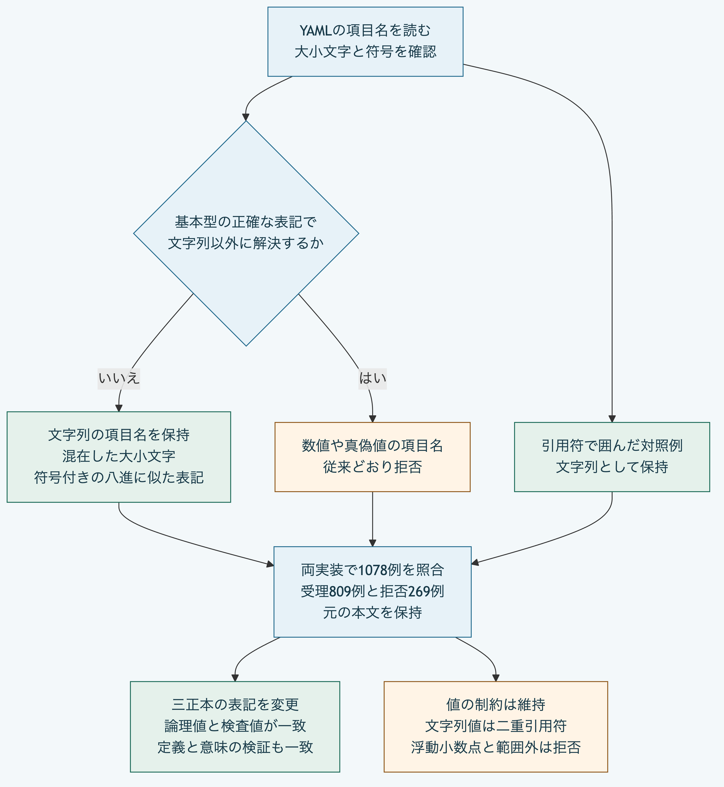

# YAMLの項目名を正確な大小文字と符号で型判定する

Pythonは、引用符のない項目名の `.nAn` や `.iNF` を大小文字を区別せずに数値と判定し、拒否していました。
また、`+0o7` や `-0xAf` も数値として拒否していました。
現在のNode.jsはこれらを文字列の項目名として読めるため、同じ正本をPythonで読めない不一致がありました。

[YAML 1.2.2のCoreの型判定](https://yaml.org/spec/1.2.2/#1032-tag-resolution)では、非数と無限大は列挙された大小文字の表記に限ります。
八進と十六進の表記には符号を含めません。
それ以外の表記は文字列になるため、Pythonの項目名の判定も同じ規則へ限定しました。

## 修正後の扱い

| 項目名の例 | 引用符のない場合 | 引用符で囲んだ場合 |
|---|---|---|
| `.nAn`、`.iNF`、`+.iNf` | 文字列として保持 | 文字列として保持 |
| `+0o7`、`-0xAf` | 文字列として保持 | 文字列として保持 |
| `.nan`、`.NaN`、`.NAN` | 数値になるため拒否 | 文字列として保持 |
| `.inf`、`.Inf`、`-.INF` | 数値になるため拒否 | 文字列として保持 |
| `0o7`、`0xAf` | 数値になるため拒否 | 文字列として保持 |
| `true`、`False`、`null`、`1.0` | 文字列にならないため拒否 | 文字列として保持 |

この変更は項目名の型判定に限ります。
文字列の値には二重引用符が必要です。
浮動小数点、範囲外の整数、`+1`と`-0`などの禁止表記は引き続き拒否します。
大小文字の混在した文字列の項目名を許すことは、同じ表記を引用符のない文字列値として許すことを意味しません。

## 共通の期待値と照合

非数、無限大、真偽値とnullの大小文字、八進と十六進に似た表記の符号、整数と範囲外の値を組み合わせました。
引用符のない項目名、明示した項目名、配列内の項目名、二重引用符、単一引用符及び引用符のない値を区別します。
期待値は型判定の規則から明示し、どちらかの実装の出力を正解として使いません。

共通例は1,078件で、受理809件と拒否269件です。
Node.js、Python 3.14.10と3.15.2で結果が一致しました。
受理時は論理値を比較し、拒否時は成功結果がないことを確認します。
読取の前後で、ファイルの本文が同じであることも照合します。

同梱Schemaを持つ正本では、拡張の対応表と配列内の対応表にこれらの文字列の項目名を保存します。
二重引用符で囲んだ基準の正本から、引用符のない表記、明示した表記と単一引用符の三正本を作り、両実装で再読取します。
要素、版とSchema固定情報の論理値、根とSchemaの検査値及び意味の検証結果が一致します。
元の正本と変更後の本文は、検査の前後で保持されます。

[図の生成元](diagrams/yaml-scalar-key-resolution.mmd)

## 確認範囲

共通例に加え、Python自身の検査へ、混在した大小文字、符号付きの表記と引用符で囲んだ対照例を追加しました。
既存の記録の形式、文字列値の制約、数値の範囲、未知の拡張の保持と本文の不変性は維持しています。
すべてのYAML構文への対応、署名、本人性と採用権限を検証したものではありません。
