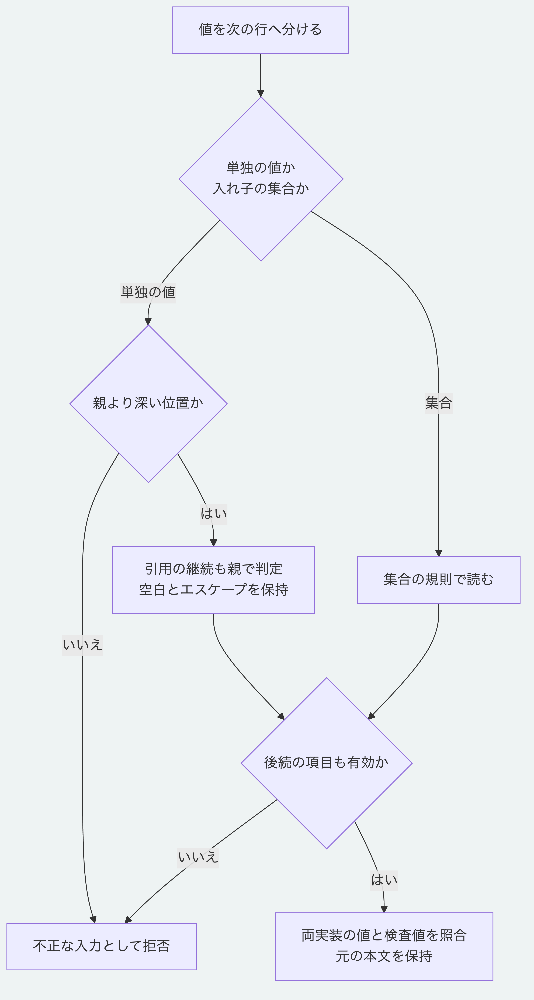

# YAMLの値を次の行へ分ける

対応表の`key:`や配列の`-`の次の行へ値を置いても、Node.jsとPythonで同じ値を読めます。
従来のPythonは、次の行を入れ子の集合として扱うため、単独の値を拒否していました。

```yaml
title:
    "first
 second"
values:
  -
    "  text  "
```

例の`title`は`"first second"`、`values`は両端の空白を持つ文字列1件の配列です。
[YAML 1.2.2の値の配置](https://yaml.org/spec/1.2.2/#block-nodes)では、単独の値とその継続行を親より深い位置へ置きます。
最初の引用符を深く字下げしても、継続行の位置をその列へ固定しません。
同じ行に配列記号を重ね、最後の記号の次の行へ値を置く場合も扱います。

引用文字列、整数、真偽値、許可した位置の`null`と空の配列及び対応表を、同じ行に書いた場合と同じ論理値として読みます。
単独の値の後は次の項目へ戻り、余分な値や暗黙の複数行の項目名を拒否します。
入れ子の集合には従来の規則を使い、対応表の親と同じ列に置く配列も引き続き扱います。
不正な字下げ、引用しない文字列、角括弧や波括弧で囲む空でない集合、浮動小数、タグとタブの拒否及びPythonの深さの上限は維持します。

## 実行確認

リポジトリ直下で実行します。
Node.js 26.13.0とPython 3.14及び3.15で確認しています。

```sh
node --test packages/kernel/test/yaml-separated-values.test.js
MORIVYX_REFERENCE_PYTHON=python3 node --test tools/python-yaml-separated-values-conformance.test.mjs
python3 -B -m unittest discover -s packages/portable-core -p test_yaml_records.py
```

[重複のない1134例](../packages/kernel/test-support/yaml-separated-value-cases.mjs)で、有効714例と拒否420例の期待値を両実装へ照合します。
7種類の配置と複数の字下げに加え、折り返し、空行、エスケープした改行と文字の正規化も確認します。
SDKの保存形式の3つの正本でも、要素、Schemaの固定情報と版の値を次の行へ分け、論理値、検査値、意味検証と本文の保持を確認します。
書き出す記法、意味契約と過去の保存資料の期待値は変更しません。
一般的なYAMLの全構文への適合を認定する検査ではありません。



[図の生成元](diagrams/yaml-separated-values.mmd)

[Pythonの対象範囲](../packages/portable-core/README.md)と[仕様の入口](README.md)を参照してください。
