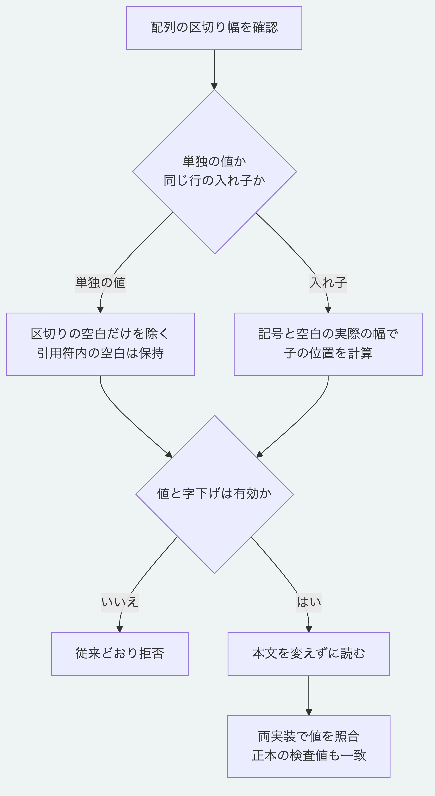

# YAML配列の区切り空白と入れ子を読む

配列の`-`の後に複数の空白を置いても、Node.jsとPythonで同じ値を読めます。
従来のPythonは区切りを1空白と仮定していたため、有効な文字列、対応表と入れ子の配列を拒否していました。
[YAML 1.2.2の配列の規則](https://yaml.org/spec/1.2.2/#block-sequences)に合わせ、同じ行の入れ子では記号とその後の空白を字下げへ含めます。

```yaml
items:
  -   first: "one"
      second: "two"
  -   "  text  "
```

この例の最初の項目は`first`と`second`を持つ対応表です。
次の項目は両端の空白を含む文字列で、引用符の外側の区切りと区別します。
後続の項目の字下げは、最初の項目の実際の位置へ合わせます。
誤った字下げ、値の省略、引用しない文字列とタブは引き続き拒否します。
Pythonの深さの上限と既存の入力の制限も維持します。

## 実行確認

リポジトリ直下で実行します。
Node.js 26.13.0とPython 3.14及び3.15で確認しています。

```sh
node --test packages/kernel/test/yaml-sequence-spacing.test.js
MORIVYX_REFERENCE_PYTHON=python3 node --test tools/python-yaml-sequence-spacing-conformance.test.mjs
python3 -B -m unittest discover -s packages/portable-core -p test_yaml_records.py
```

[共通の292例](../packages/kernel/test-support/yaml-sequence-spacing-cases.mjs)は、4種類の区切り幅と4種類の字下げで、有効な192例と拒否する100例を照合します。
文字列、整数、真偽値、空の配列と対応表、同じ行の入れ子、明示した項目名、折り返し及び後続の項目を含みます。
SDKの保存形式の正本でも、要素とSchemaの固定情報に1、2及び5個の区切り空白を使い、両実装の根とSchemaの検査値及び意味検証を確認します。
入力の本文は変更しません。

修正は[yaml_records.py](../packages/portable-core/yaml_records.py)に限られ、出力する記法、意味契約と既存の固定資料の期待値は変更しません。
この検査は、一般的なYAMLの全構文への適合を認定するものではありません。



[図の生成元](diagrams/yaml-sequence-spacing.mmd)

[Pythonの対象範囲](../packages/portable-core/README.md)と[仕様の入口](README.md)を参照してください。
