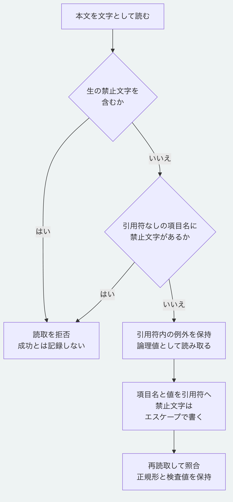

# YAMLの文字とエスケープ

正本のYAMLへ制御文字を含める場合は、二重引用符の中でエスケープします。
例えば、次の文字列は`a`と`b`の間に`U+0000`を保持します。
本文に生の`U+0000`を書いた入力は拒否します。

```yaml
field: "a\u0000b"
```

## 読取の条件

本文はUTF-8、BOMなし、LF改行、末尾改行一件とします。
`C0`制御文字は`U+0000`から`U+001F`までの範囲です。
LF（`U+000A`）を除き、引用符の有無にかかわらず生では使えません。
タブとCRも、この禁止範囲に含みます。

[YAML 1.2.2の5.1節](https://yaml.org/spec/1.2.2/#51-character-set)は、JSON互換のため、引用符内の非`C0`文字を受け入れる例外を定めています。
この例外は保持しており、非`C0`文字を本文全体から一律に拒否しません。

引用符なしの項目名は、印字可能文字の範囲に従います。
`DEL`は`U+007F`、`C1`は`U+0080`から`U+009F`、`NEL`はその中の`U+0085`です。
`DEL`、`NEL`を除く`C1`及び`U+FFFE`と`U+FFFF`を項目名へ入れる場合は、引用符とエスケープを使います。
`NEL`、Unicodeの行区切り文字と補助面の非文字を、必要以上に拒否しません。

```yaml
"a\u007fb": "value"
```

読取の結果は論理値です。
元のエスケープのつづりや引用方法を、そのまま保持する機能ではありません。

## 書出しと検査値

Node.jsとPythonの書出しは、印字できない文字を引用符内のエスケープで表します。
項目名も先に二重引用符へ入れ、引用符なしの項目名へエスケープ文字列を挿入して別の名前になることを防ぎます。
タブを含む論理値も、生のタブを出さずに書き出します。
通常の報告も同じ共通の書出しを経由します。

再読取した論理値、正規JSONとRevisionの検査値は保持します。
エスケープのつづりは実装間で異なる場合がありますが、元の論理値を変えません。
公開APIと検査値の接頭辞、過去の固定資料、由来の一覧と初期公開タグは変更しません。
以前に保存した生の禁止文字を含む本文を、自動で修復または上書きすることもありません。

## 回帰試験

空白と制御文字を項目名、値と構文の間へ入れた567入力を照合します。
67種の文字を項目名と値に入れ、両書出しの結果を両読取で読み、正規形と検査値を確認します。
通常の中核適合とPythonの単体試験にも、禁止入力、引用符内の例外と往復の試験を含めています。

```sh
npm run conformance --prefix packages/kernel
python3 -B -m unittest discover -s packages/portable-core -p 'test_*.py'
node --test tools/python-yaml-source-characters-conformance.test.mjs
```

Python 3.15の実行ファイルを明示して相互照合する場合は、最後のコマンドへ`MORIVYX_REFERENCE_PYTHON`を環境変数として渡します。



[図の生成元](diagrams/yaml-source-characters.mmd)
